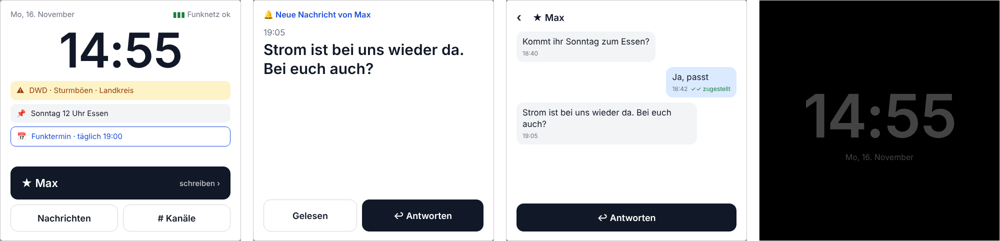

# HomeMesh

A desk unit for text messaging over a [MeshCore](https://github.com/meshcore-dev/MeshCore) LoRa mesh, without internet or mobile network.

Design mockup, not a screenshot of the firmware.

> **Status:** planning. There is no HomeMesh firmware code in this repository yet.
> This is a personal project. There is no prebuilt firmware.

## Why

Phones and the internet fail together: in a power cut, a network outage or a storm. A LoRa mesh keeps working as long as the repeaters have power. HomeMesh puts that on a table at home, for people who don't want to deal with radio technology.

The device looks and behaves like a small clock with a screen. Messages from family arrive in full screen, replies are typed on a large on-screen keyboard or picked from quick replies. There are no menus about frequencies, hops or channels in everyday use.

## Hardware

| | |
|---|---|
| Device | Seeed SenseCAP Indicator D1L |
| MCU | ESP32-S3 (UI, radio, Bluetooth, Wi-Fi) + RP2040 (buzzer) |
| Display | 3.95" 480×480 capacitive touch |
| Radio | SX1262, 868 MHz |
| Input | touch, one button |
| Power | USB-C only, no battery – a power bank keeps it running during a power cut |

## How it works

HomeMesh is a regular **MeshCore companion** with its own on-device interface.

- **Setup happens in the MeshCore app:** contacts, favourites, channels, radio settings and scope. The firmware never creates contacts or channels on its own.
- **The app keeps working** over Bluetooth at any time. The display shows messages whether the app is connected or not.
- **Favourites** (marked in the app) get a large shortcut button on the home screen, with an optional display-only name.

## Planned features

**Home screen**
- Large clock and date, radio status ("signal ok" / "no signal")
- Shortcut buttons for favourites, plus *Messages* and *Channels*
- A pinned note and the next appointment
- A one-line notice for real alerts from a warning bot channel (status replies and queries are ignored)

**Messages**
- Messages from favourites open in full screen with one sound (buzzer on the RP2040). After 10 minutes without a touch the screen dims. Several unread messages are collected on one screen. After one hour the full screen closes and a counter remains.
- Messages from other contacts arrive quietly with a counter.
- Delivery status per message (on the way / delivered / not delivered) and a *Send again* button.
- Channels can be read and written, without notifications.

**Night mode**
- Configurable quiet hours: dark theme, dimmed backlight, clock only, no sound.

**Remote commands** – sent as direct messages from a favourite; they never show up in the chat on the device:

| Command | Effect |
|---|---|
| `!status` | radio, repeaters heard, uptime, time source, last read message |
| `!pin <text>` / `!unpin` | set or clear the pinned note |
| `!termin <name> <day> <time>` | add an appointment with a reminder (e.g. `!termin Anrufen morgen 19:00`) |
| `!termine` | list appointments |
| `!klingeln` | ring and flash until someone taps the screen |
| `!nachtruhe 22-7` | set quiet hours |
| `!update` | open the Wi-Fi update page |

The device language is German, so the command names are too.

**Maintenance**
- Technical page with repeaters heard, signal and time source
- Placement helper: live signal bar while carrying the device around
- Wi-Fi firmware update from the settings, with QR codes for the phone
- QR code to add the device as a contact
- Writes settings and history safely, so a power cut does not lose data

## Status

The firmware builds but has not run on the device yet. Hardware tests come next.

## Building

| Environment | What it is |
|---|---|
| `SenseCapIndicator_HomeMesh` | HomeMesh firmware for the ESP32-S3 |
| `SenseCapIndicator_HomeMesh_rp2040` | Small buzzer firmware for the RP2040 (`examples/homemesh_rp2040`). Flash `firmware.uf2`: hold the button on the underside while plugging in USB, then copy the file to the RPI-RP2 drive. |
| `SenseCapIndicator_HomeMesh_bringup` | Stock companion with the upstream UI, for a first radio test |

The interface lives in `examples/companion_radio/ui-homemesh`. Pure logic (time zone, appointments, remote commands, storage, signal meter) is header-only and covered by unit tests in `test/test_homemesh_*`. A desktop and a browser simulator of the interface are in `ui-homemesh/sim`.

## Repository layout

- `main` follows upstream MeshCore unchanged.
- `dev` holds the HomeMesh work and is the default branch.
- Files from upstream MeshCore are left as they are, except for three small marked hooks in `examples/companion_radio/MyMesh.h/.cpp`, so upstream updates can be merged cleanly.

## License

MIT, see [license.txt](license.txt). Based on MeshCore by Scott Powell and contributors.
